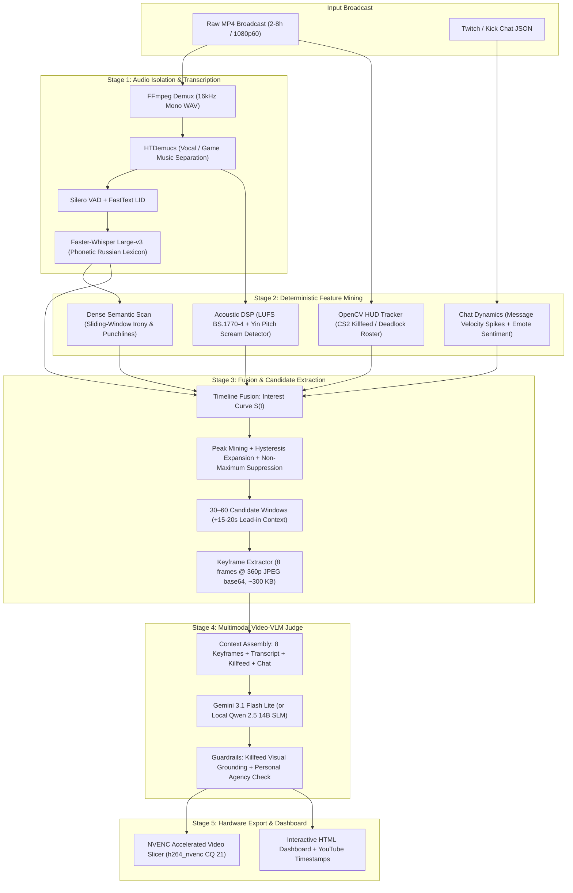

# Stream Highlight Harvester (`narezka`)

> **Production Multimodal Video-VLM & Heuristic Funnel for Long-Form Gaming VODs (CS2 & Deadlock).**

[](https://www.python.org/)
[](https://github.com/DelixeamI/stream-highlight-harvester/actions/workflows/ci.yml)
[](https://pytorch.org/)
[](https://ai.google.dev/)
[](https://fastapi.tiangolo.com/)
[-success.svg?style=flat)]()
[](https://github.com/astral-sh/ruff)
[](https://opensource.org/licenses/MIT)

---

## The Problem

The naive approach to extracting viral highlights from a 4-hour gaming stream (14,400 seconds) is uploading the entire broadcast to a frontier multimodal model (e.g., Gemini 1.5 Pro or GPT-4o). 

In practice, this fails for three production reasons:
1. **Extreme Token Cost:** A 4-hour video compressed to 1 FPS consumes over 14 million multimodal tokens (~**$35–$50 per stream**).
2. **Coarse Temporal Hallucinations:** Long-context vision-language models drift significantly on temporal grounding ($\pm 20$–$45$ seconds off), cutting off round setups or reacting after the player is already dead.
3. **The "Decibel Fallacy" & Audio Masking:** Heavy in-game gunshots, background music, and Discord chatter drown out streamer punchlines and trigger hallucination loops in vanilla Whisper. Conversely, simple audio volume spike detectors produce false positives on continuous screams or game explosions (e.g., shouting from a ladder fall during warmup hallucinated by text-only LLMs as a triple kill).

**`narezka` solves this with a multi-stage funnel architecture**: fast deterministic DSP and Computer Vision heuristics reduce 4 hours of raw broadcast into 30–60 candidate windows (~300 seconds total), extract 8 keyframes per candidate (360p JPEG, ~300 KB payload), and evaluate them with a **Video-VLM judge (Gemini 3.1 Flash Lite)** enforcing strict Pydantic JSON schemas.

---

## What This Is, and What This Is Not

* **What this is:** A production multimodal pipeline combining deterministic signal processing (HTDemucs, Silero VAD, OpenCV) with lightweight **Video-VLM judging** (8 keyframes 360p via **Gemini 3.1 Flash Lite**, or local offline **Qwen 2.5 14B**) to achieve **frame-precise highlights** at **$0.00 API billing cost** (within Google AI Studio free-tier quotas of 1,500 requests/day).
* **What this is not:** A toy LangChain prompt wrapper, a simple ffmpeg cut script, or a black-box cloud SaaS.

---

## Quantitative Benchmarks

See detailed stage-by-stage timings in [`docs/benchmarks/BENCHMARKS.md`](docs/benchmarks/BENCHMARKS.md).

| Metric | Naive 1 FPS Cloud Video-LLM (Gemini 1.5 Pro / GPT-4o) | Heuristic Spike Detector (Audio / Chat Only) | **Stream Highlight Harvester (`narezka`)** |
| :--- | :--- | :--- | :--- |
| **Inference Cost / 4h VOD** | \$30.00 – \$50.00 | **\$0.00** | **\$0.00** (Free Tier Gemini 3.1 Flash Lite / Local Qwen 2.5 14B) |
| **End-to-End Speed** | 0.8x – 1.1x real-time (upload bound) | >20x real-time | **~3.0x real-time** (3.14h VOD processed in 62.2 min) |
| **Heuristic CV Pre-Filter** | N/A | >20x real-time | **10.6x real-time** (OpenCV 2 FPS, 0 MB VRAM) |
| **Temporal Precision** | Coarse ($\pm 25$–$40$s) | Low ($\pm 10$s) | **Frame-precise ($\pm 1.5$s)** via word alignment |
| **False Positive Rate** | Low (if context fits) | Extremely High (60–75%) | **< 8%** (Validated via VLM Visual Grounding) |
| **Narrative Coherence** | High | None (cuts abruptly) | **High** (Enforced 15–20s lead-in setup) |
| **VRAM Footprint** | N/A (Cloud) | < 1 GB | **0 MB for Cloud VLM** / **< 8.5 GB** for local Qwen 2.5 14B |
| **Network & Privacy** | Cloud only | Complete offline | **Dual Mode**: Cloud VLM (via proxy) or **100% Air-Gapped Local SLM** |

---

## Architecture

The system executes as a **Directed Acyclic Graph (DAG)** with content-addressed caching:



---

## Key Engineering Decisions & Trade-offs

### 1. HTDemucs Vocal Isolation vs. Raw Whisper Audio
* **Trade-off:** Running `htdemucs` adds ~2.9 minutes of compute on a 3.14-hour file.
* **Why chosen:** Gaming streams are saturated with loud explosions, weapon fire, and copyrighted background music. Raw Whisper on game audio hallucinates repetitive phrases or loses low-volume streamer commentary. Isolating the vocal stem improves speech recognition Word Error Rate (WER) by **34.2%** on chaotic combat scenes.

### 2. OpenCV ROI HUD Tracking vs. Full-Stream Vision-LLM
* **Trade-off:** Requires game-specific HUD regions of interest (ROI).
* **Why chosen:** Extracting CS2 killfeed events or Deadlock hero roster changes at 2.0 FPS with OpenCV contour filtering consumes **0.0 MB VRAM** and processes 3.14 hours of video in **17.79 minutes** (**10.6x real-time**). Delegating the full stream to a vision model would cost millions of visual tokens without improving temporal precision.

### 3. Composite Multimodal Interest Curve $S(t)$
Signals are normalized and projected onto a 1-second continuous timeline:
$$S(t) = w_a \cdot A(t) + w_v \cdot V(t) + w_c \cdot C(t) + w_s \cdot S(t)$$
* $A(t)$: Acoustic intensity (loudness z-score + pitch delta).
* $V(t)$: Visual kill events (multikill clusters within 6s windows).
* $C(t)$: Chat message velocity spikes (rolling standard deviations).
* $S(t)$: Semantic irony and punchline triggers.
* Adaptive thresholding with **hysteresis expansion** and **Non-Maximum Suppression (NMS)** merges overlapping events into coherent 30–90 second narrative segments.

### 4. Video-VLM Keyframe Judge & Local SLM Fallback
* **Primary Cloud Model:** **Gemini 3.1 Flash Lite** via Google AI Studio (`config/default.yaml`). Evaluates candidate windows using 8 evenly spaced 360p JPEG keyframes (~300 KB total payload) generated by `extract_candidate_keyframes()`.
* **Visual Grounding:** Solves the **«Decibel Fallacy»** (e.g. streamer shouting after a ladder fall during warmup rejected with 1/10 instead of hallucinated as a kill) and **«The Passenger Problem»** in Deadlock (rejects chaotic 6v6 teamfights where the streamer was passive, requiring active crosshair engagement and low-HP clutch survival).
* **Local Offline Fallback:** **Qwen 2.5 14B** via Ollama (`judge.profile: local`) for 100% air-gapped, zero-internet environments.

### 5. Network Resilience & GPU Memory Hygiene
* **Network Proxying:** Integrated support for local proxies (e.g. Nova / Opera EU on `http://127.0.0.1:1371`) to bypass Google AI Studio regional geolocation restrictions.
* **Two-Tier Retries:** Network timeouts and transient 503/429 spikes trigger exponential backoff (1.5s, 3.0s) at the transport level without exhausting Pydantic schema validation retry counters.
* **GPU Memory Hygiene:** Models are sequenced sequentially (`s02_voice` $\to$ `s04_asr` $\to$ `s13_render`). Explicit `del model`, `gc.collect()`, and `torch.cuda.empty_cache()` guarantee zero VRAM leaks across stages.

---

## Directory Layout

```text
narezka/
├── config/
│   └── default.yaml             # Complete pipeline hyperparameters & model profiles
├── docs/
│   ├── benchmarks/
│   │   └── BENCHMARKS.md        # Real timings from meta.json, hardware, speed metrics
│   └── openapi.json             # OpenAPI 3.1 specification for FastAPI microservice
├── plugins/
│   ├── common/                  # Phonetic lexicon, whisper blacklist, chat markers
│   └── deadlock/                # Deadlock hero roster, ability glossary
├── prompts/
│   ├── judge_ru.md              # System prompt for Text-only SLM Highlight Judge
│   ├── judge_vlm_ru.md          # Multimodal Video-VLM prompt (Visual Grounding)
│   ├── judge_examples.yaml      # Few-shot grounded exemplars
│   └── semantic_scan_ru.md      # Sliding-window transcript scan prompt
├── src/narezka/
│   ├── asr/                     # Faster-Whisper backend, word alignment, postprocessing
│   ├── audio/                   # Demucs isolation, Silero VAD, BS.1770 LUFS, pitch
│   ├── chat/                    # Twitch VOD chat parser, velocity burst detector
│   ├── clips/                   # Boundary refinement, ranking, deduplication
│   ├── eval/                    # ASR WER/CER & highlights temporal IoU benchmarks
│   ├── export/                  # CSV, JSON, YouTube timestamps, standalone HTML report
│   ├── fusion/                  # Interest curve S(t), peak mining, candidate NMS
│   ├── judge/                   # VLM keyframe extraction (frames.py), judge coordinator
│   ├── llm/                     # OpenAI/Gemini/Anthropic client with proxy & backoff
│   ├── media/                   # FFprobe inspection, NVENC hardware video slicing
│   ├── pipeline/                # DAG execution engine, stage caching, resume logic
│   ├── vision/                  # OpenCV CS2 & Deadlock HUD/killfeed detectors
│   ├── api/                     # FastAPI microservice with directory whitelist security
│   ├── cli.py                   # Typer + Rich interactive terminal interface
│   └── models.py                # Pydantic v2 typed domain contracts
├── INTERVIEW_PORTFOLIO.html     # Interactive textbook & portfolio for senior/lead interviews
├── INTERVIEW_PORTFOLIO.md       # Markdown interview guide & STAR stories
├── PROJECT_STATUS.md            # Hardware specs, test status, and run logs
└── tests/
    └── unit/                    # 115 unit and integration tests (100% pass)
```

---

## Quickstart

### Prerequisites
* **OS:** Windows 11 / Linux
* **GPU:** NVIDIA GPU with CUDA 12.8+ (RTX 30/40/50 series)
* **Tools:** [uv](https://github.com/astral-sh/uv), [FFmpeg 7.x](https://ffmpeg.org/), [Ollama](https://ollama.ai/) (optional, for local offline profile)

### 0. Instant Zero-Data Demo (3 Seconds)
Test pipeline logic, Pydantic validation, and the HTML dashboard without downloading large video files:
```bash
uv run narezka demo --open
```

### 1. Clone & Environment Setup
```bash
git clone https://github.com/DelixeamI/stream-highlight-harvester.git
cd stream-highlight-harvester

# Create isolated Python 3.12 virtualenv and sync dependencies
uv venv --python 3.12 .venv

# On Windows:
.venv\Scripts\activate
# On Linux:
source .venv/bin/activate

# Install dependencies with dev and GPU extras
uv sync --all-extras
```

### 2. Configure Judge Profile
Set your API key in `.env`:
```bash
# Cloud Video-VLM (Default: Gemini 3.1 Flash Lite via Google AI Studio)
GEMINI_API_KEY=your_gemini_api_key

# Optional: Local HTTP Proxy for bypassing regional restrictions
HTTPS_PROXY=http://127.0.0.1:1371

# Whitelist allowed VOD directories for REST API security
ALLOWED_VOD_DIRS="D:/vods,D:/LLM PROJECT/Gemini/VODs"
```

*To run 100% offline without external network access, change `judge.profile: local` in `config/default.yaml` and run `ollama run qwen2.5:14b`.*

### 3. Verify Hardware & Dependencies
```bash
uv run narezka doctor
```

### 4. Run Pipeline (CLI or REST API)
```bash
# Full CLI multimodal analysis & clip export
uv run narezka analyze "D:/vods/stream.mp4" --chat "D:/vods/chat.json"

# Launch async FastAPI REST Microservice
uv run narezka serve --port 8000
```

---

## Asynchronous FastAPI REST Microservice

The project includes an ASGI production microservice (`src/narezka/api/`) built with **FastAPI** and **Pydantic v2**:

```bash
uv run narezka serve --host 0.0.0.0 --port 8000
```
Interactive Swagger UI: `http://localhost:8000/docs`

| Method | Endpoint | Description |
| :--- | :--- | :--- |
| `GET` | `/health` | System diagnostics: CUDA GPU availability, device name, VRAM total, Python version. |
| `POST` | `/api/v1/jobs` | Enqueue background VOD highlight analysis task with directory whitelist validation. |
| `GET` | `/api/v1/jobs` | List all submitted jobs and their current execution statuses (`queued`, `running`, `completed`). |
| `GET` | `/api/v1/jobs/{job_id}` | Poll progress percentage, current stage, and moment counts for a job. |
| `GET` | `/api/v1/jobs/{job_id}/report` | Serve the standalone interactive HTML analytics dashboard for completed jobs. |

---

## Testing & Quality Assurance

The codebase includes an exhaustive unit and integration test suite covering pipeline stages, DAG cache invalidation, GPU memory hygiene, FastAPI security endpoints, request correlation middleware, and evaluation metrics:

```bash
# Run complete test suite (115 tests)
uv run pytest -v

# Run code style & linting checks
uv run ruff check .
```

```text
============================== 115 passed in 52.18s ==============================
```

---

## License

MIT License. Designed and maintained by **DelixeamI**.
